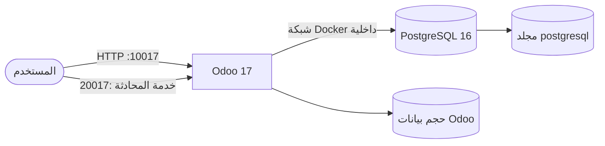
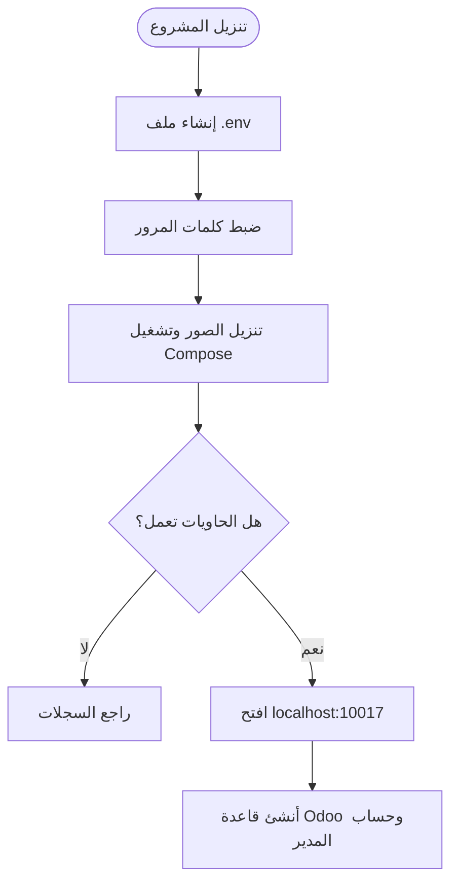
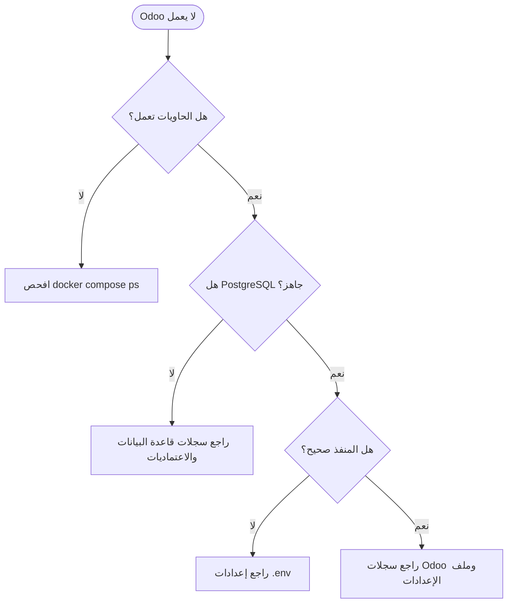

<div dir="rtl" align="right">

# دليل تثبيت Odoo 17 باستخدام Docker Compose

**Odoo 17 · PostgreSQL 16 · Docker Compose · دعم Traefik اختياري**

دليل عملي لتثبيت Odoo 17 وإدارته على Ubuntu/Linux، مع خيار تشغيل أكثر من
نسخة على الخادم نفسه.

[ابدأ التثبيت](#-التثبيت-السريع) · [تشغيل نسخ متعددة](#-تشغيل-أكثر-من-نسخة) ·
[إدارة الحاويات](#-إدارة-الحاويات) · [استكشاف الأخطاء](#-استكشاف-الأخطاء)

</div>

---

## 📑 المحتويات

1. [نظرة عامة](#-نظرة-عامة)
2. [المتطلبات](#-المتطلبات)
3. [معلومات الدخول والمنافذ](#-معلومات-الدخول-والمنافذ)
4. [التثبيت السريع](#-التثبيت-السريع)
5. [تشغيل أكثر من نسخة](#-تشغيل-أكثر-من-نسخة)
6. [الإعدادات](#️-الإعدادات)
7. [إدارة الحاويات](#-إدارة-الحاويات)
8. [النسخ الاحتياطي](#-النسخ-الاحتياطي)
9. [الصلاحيات وإعداد Linux](#️-الصلاحيات-وإعداد-linux)
10. [Traefik وHTTPS](#-traefik-وhttps-اختياري)
11. [استكشاف الأخطاء](#-استكشاف-الأخطاء)
12. [هيكل المشروع والأمان](#-هيكل-المشروع-والأمان)
13. [روابط مفيدة](#-روابط-مفيدة)

---

## 🔎 نظرة عامة

يشغّل المشروع Odoo 17 وقاعدة PostgreSQL 16 داخل حاويات Docker. تبقى قاعدة
البيانات على شبكة داخلية ولا يُنشر منفذها على الإنترنت.



| الخدمة | الصورة | منافذ المضيف الافتراضية | حفظ البيانات |
|---|---|---|---|
| Odoo | `odoo:17` | `10017` للويب، `20017` للمحادثة | حجم Docker باسم `odoo_data` |
| PostgreSQL | `postgres:16` | غير مكشوف للمضيف | المجلد `postgresql/` |

---

## ✅ المتطلبات

- Ubuntu 22.04/24.04 أو توزيعة Linux مناسبة.
- Docker Engine.
- Docker Compose v2، ويُستخدم بالأمر `docker compose`.
- اتصال بالإنترنت عند تنزيل الصور أول مرة.
- توفر المنفذين `10017` و`20017`، أو اختيار منافذ بديلة.

تحقق من توفر الأدوات:

```bash
docker --version
docker compose version
docker run --rm hello-world
```

> على Windows، نفّذ الأوامر عبر WSL 2 بعد تفعيل تكامل Docker مع WSL.

---

## 🔐 معلومات الدخول والمنافذ

| البيان | القيمة الافتراضية | الاستخدام |
|---|---|---|
| كلمة مرور Odoo الرئيسية | `Admin@17` | إدارة قواعد البيانات من واجهة Odoo |
| مستخدم PostgreSQL | `odoo17` | اتصال Odoo بقاعدة البيانات |
| كلمة مرور PostgreSQL | `odoo@17` | اتصال Odoo بقاعدة البيانات |
| قاعدة PostgreSQL الابتدائية | `postgre` | قاعدة تُنشأ عند تهيئة PostgreSQL لأول مرة |
| واجهة Odoo | `http://localhost:10017` | استخدام النظام من المتصفح |
| منفذ المحادثة المباشرة | `http://localhost:20017` | خدمة المحادثة والاتصال المباشر |

> كلمة مرور Odoo الرئيسية ليست كلمة مرور حساب المستخدم الذي ستنشئه داخل
> قاعدة بيانات Odoo. غيّر كلمات المرور الافتراضية قبل إتاحة الخادم للإنترنت.

---

## 🚀 التثبيت السريع

### 1. تنزيل المشروع

```bash
git clone https://github.com/abdalazeim/InstallingOdoo17-Docker-Deployment.git
cd InstallingOdoo17-Docker-Deployment
```

يمكن أيضًا تنزيل المستودع كملف ZIP وفك ضغطه، ثم فتح الطرفية داخل مجلد المشروع.

### 2. إعداد ملف البيئة والصلاحيات

```bash
cp .env.example .env
chmod 600 .env
mkdir -p postgresql
chmod 700 postgresql
chmod +x entrypoint.sh
```

عدّل ملف `.env` وضع كلمات مرور قوية بدل القيم التجريبية قبل النشر العام.

### 3. تشغيل Odoo وPostgreSQL

```bash
docker compose pull
docker compose up -d
docker compose ps
```

### 4. فتح النظام

- واجهة Odoo: [http://localhost:10017](http://localhost:10017)
- منفذ المحادثة المباشرة: [http://localhost:20017](http://localhost:20017)

المنفذ `20017` مخصص لخدمة الاتصال المباشر، وليس واجهة ويب ثانية لـ Odoo.

### مسار التثبيت



---

## 🔁 تشغيل أكثر من نسخة

يتضمن المستودع `run.sh` لتثبيت كل نسخة في مجلد مستقل، مع منافذ وأسماء
حاويات وشبكات منفصلة. يتطلب السكربت Git وDocker وDocker Compose v2.

شغّل الأوامر من مجلد المستودع:

```bash
# النسخة الأولى: odoo-live
sudo bash run.sh --destination odoo-live --port 10017 --chat 20017

# النسخة الثانية: odoo-test
sudo bash run.sh --destination odoo-test --port 11017 --chat 21017
```

| النسخة | مجلد التثبيت | رابط Odoo | منفذ المحادثة |
|---|---|---|---|
| `odoo-live` | `odoo-live/` | [http://localhost:10017](http://localhost:10017) | `20017` |
| `odoo-test` | `odoo-test/` | [http://localhost:11017](http://localhost:11017) | `21017` |

يستنسخ السكربت المستودع إلى مجلد الوجهة، ثم ينشئ `.env` ويضبط المنافذ
والأسماء ويشغّل الخدمات. يجب أن يكون مجلد الوجهة جديدًا وغير موجود مسبقًا.
بعد التثبيت، أدر كل نسخة من داخل مجلدها:

```bash
cd odoo-live
docker compose ps
docker compose logs -f
```

### التثبيت مباشرة من GitHub

يمكن تنزيل المشغّل من المستودع وتشغيله دون استنساخ يدوي مسبقًا:

```bash
curl -fsSL https://raw.githubusercontent.com/abdalazeim/InstallingOdoo17-Docker-Deployment/main/run.sh \
  | sudo bash -s -- --destination odoo-live --port 10017 --chat 20017

curl -fsSL https://raw.githubusercontent.com/abdalazeim/InstallingOdoo17-Docker-Deployment/main/run.sh \
  | sudo bash -s -- --destination odoo-test --port 11017 --chat 21017
```

> لا تشغّل سكربتًا منزّلًا مباشرة إلا بعد التأكد من مصدره ومراجعة محتواه.

---

## ⚙️ الإعدادات

تُدار الإعدادات من ملف `.env`. لا ترفع هذا الملف إلى GitHub؛ فهو يحتوي على
كلمات المرور.

| المتغير | القيمة الافتراضية | الغرض |
|---|---|---|
| `ODOO_IMAGE` | `odoo:17` | صورة Odoo |
| `PG_IMAGE` | `postgres:16` | صورة PostgreSQL |
| `POSTGRES_USER` | `odoo17` | مستخدم PostgreSQL |
| `POSTGRES_PASSWORD` | `odoo@17` | كلمة مرور PostgreSQL |
| `POSTGRES_DB` | `postgre` | قاعدة PostgreSQL الابتدائية |
| `ODOO_ADMIN_PASSWORD` | `Admin@17` | كلمة مرور Odoo الرئيسية |
| `ODOO_HTTP_PORT` | `10017` | منفذ الويب على المضيف |
| `ODOO_CHAT_PORT` | `20017` | منفذ المحادثة على المضيف |
| `ODOO_NETWORK` | `odoo17_internal` | شبكة Docker الداخلية |
| `ODOO_DOMAIN` | مطلوب لـ Traefik | اسم النطاق |
| `DOCKER_PROXY_NETWORK` | `proxy` | شبكة Traefik الموجودة |
| `CERTSRESOLVER` | `letsencrypt` | اسم محلّل الشهادات في Traefik |

مثال تغيير المنافذ:

```dotenv
ODOO_HTTP_PORT=11017
ODOO_CHAT_PORT=21017
```

بعد التعديل طبّق الإعدادات:

```bash
docker compose up -d
```

> **قاعدة موجودة مسبقًا:** قيم `POSTGRES_USER` و`POSTGRES_PASSWORD` و
> `POSTGRES_DB` تُستخدم لتهيئة مجلد البيانات أول مرة فقط. تعديل `.env` لاحقًا
> لا يغيّر بيانات اعتماد قاعدة موجودة.

لإضافة وحدات Odoo، ضع كل وحدة مخصصة داخل مجلد `addons/`. إعدادات Odoo موجودة
في `etc/odoo.conf`.

---

## 🧰 إدارة الحاويات

نفّذ الأوامر من مجلد النسخة المطلوبة:

| العملية | الأمر |
|---|---|
| تشغيل الخدمات | `docker compose up -d` |
| حالة الخدمات | `docker compose ps` |
| عرض كل السجلات | `docker compose logs -f` |
| سجلات Odoo | `docker compose logs -f odoo17` |
| سجلات PostgreSQL | `docker compose logs -f db` |
| إعادة التشغيل | `docker compose restart` |
| إيقاف مؤقت | `docker compose stop` |
| الإيقاف وحذف الحاويات مع الاحتفاظ بالبيانات | `docker compose down` |

إعداد `restart: always` يعيد تشغيل الحاويات تلقائيًا عند تعطلها أو إعادة
تشغيل Docker.

> **تحذير:** لا تستخدم `docker compose down -v` إلا إذا كنت تقصد حذف أحجام
> Docker. ولا تحذف مجلد `postgresql/` إذا كنت تريد الاحتفاظ بقاعدة البيانات.

---

## 💾 النسخ الاحتياطي

تُحفظ قاعدة PostgreSQL في مجلد `postgresql/`، ويحفظ حجم `odoo_data` الملفات
المرفوعة ومرفقات Odoo. خذ نسخة من قاعدة البيانات والملفات معًا:

```bash
mkdir -p backups

# تصدير قواعد البيانات والأدوار
docker exec odoo17-db pg_dumpall -U odoo17 > backups/postgresql-all.sql

# أرشفة ملفات Odoo
docker exec odoo17 tar -C /var/lib/odoo -czf /tmp/odoo-data.tar.gz .
docker cp odoo17:/tmp/odoo-data.tar.gz backups/odoo-data.tar.gz
docker exec odoo17 rm -f /tmp/odoo-data.tar.gz
```

عند النسخ الاحتياطي لنسخة ثانوية أنشأها `run.sh`، استخدم أسماء الحاويات
الظاهرة في `docker compose ps` بدل `odoo17` و`odoo17-db`. خزّن النسخ خارج
الخادم أيضًا، واحمها لأنها قد تحتوي على بيانات حساسة.

---

## 🔒 الصلاحيات وإعداد Linux

### صلاحيات الملفات

لا تستخدم `chmod -R 777`؛ فهي تمنح جميع مستخدمي الخادم صلاحية القراءة
والكتابة والتنفيذ. استخدم الصلاحيات المحدودة التالية:

```bash
chmod 600 .env
chmod 700 postgresql
chmod +x entrypoint.sh
```

إذا ظهرت مشكلة صلاحيات، افحص المسار وسجلات الحاويات أولًا:

```bash
docker compose logs --tail=100
ls -ld addons etc postgresql
```

لا تجعل ملفات كلمات المرور أو بيانات قاعدة البيانات قابلة للكتابة من جميع
مستخدمي النظام.

### زيادة حد مراقبة الملفات (اختياري)

هذا التعديل على Linux فقط، وقد يفيد عند تشغيل عدة نسخ إذا ظهرت رسالة تفيد
بتجاوز حد مراقبة الملفات. لا يلزم عادةً لتثبيت نسخة واحدة.

```bash
if grep -qF "fs.inotify.max_user_watches" /etc/sysctl.conf; then
  grep -F "fs.inotify.max_user_watches" /etc/sysctl.conf
else
  echo "fs.inotify.max_user_watches = 524288" | sudo tee -a /etc/sysctl.conf
fi

sudo sysctl -p
```

للتحقق من القيمة الحالية:

```bash
sysctl fs.inotify.max_user_watches
```

---

## 🌐 Traefik وHTTPS (اختياري)

استخدم `docker-compose.traefik.yml` إذا كان Traefik يعمل مسبقًا، وكانت شبكة
Docker الخارجية الخاصة به موجودة.

1. اضبط القيم في `.env`:

   ```dotenv
   ODOO_DOMAIN=odoo.example.com
   DOCKER_PROXY_NETWORK=proxy
   CERTSRESOLVER=letsencrypt
   ```

2. أنشئ شبكة Traefik إذا لم تكن موجودة:

   ```bash
   docker network create proxy
   ```

3. شغّل وضع Traefik:

   ```bash
   docker compose -f docker-compose.traefik.yml up -d
   ```

4. افتح `https://odoo.example.com` بعد توجيه DNS وضبط Traefik.

لا تشغّل وضع Compose العادي ووضع Traefik في الوقت نفسه للنسخة نفسها.

---

## 🩺 استكشاف الأخطاء

| المشكلة | التحقق أو الحل |
|---|---|
| المنفذ مستخدم | غيّر `ODOO_HTTP_PORT` أو `ODOO_CHAT_PORT` في `.env` ثم نفّذ `docker compose up -d` |
| Odoo لا يتصل بقاعدة البيانات | راجع `docker compose logs db odoo17` وتأكد من تطابق كلمات المرور |
| فحص جاهزية PostgreSQL | `docker compose exec db pg_isready -U odoo17 -d postgre` |
| Odoo لا يبدأ بعد تعديل الإعدادات | `docker compose logs --tail=100 odoo17` |
| تغيير كلمة المرور لم يؤثر على قاعدة قديمة | بيانات PostgreSQL الموجودة لا يعاد تهيئتها تلقائيًا |
| Traefik لا يوجّه إلى Odoo | تحقق من DNS والشبكة الخارجية و`ODOO_DOMAIN` واسم محلّل الشهادات |



---

## 🗂️ هيكل المشروع والأمان

```text
InstallingOdoo17-Docker-Deployment/
├── addons/                       # إضافات Odoo المخصصة
├── etc/
│   ├── odoo.conf                 # إعدادات Odoo
│   └── requirements.txt          # متطلبات Python الاختيارية
├── postgresql/                   # بيانات PostgreSQL الدائمة
├── .env.example                  # نموذج متغيرات البيئة
├── docker-compose.yml            # تشغيل مباشر بالمنافذ
├── docker-compose.traefik.yml    # تشغيل اختياري عبر Traefik
├── entrypoint.sh                 # إعداد Odoo وانتظار PostgreSQL
├── run.sh                        # أداة تثبيت نسخ متعددة
└── README.md                     # الدليل الإنجليزي
```

### قائمة أمان سريعة

- استبدل كلمات المرور التجريبية قبل إتاحة الخادم للعامة.
- لا ترفع `.env` أو ملفات النسخ الاحتياطية إلى GitHub.
- لا تنشر منفذ PostgreSQL إلى الإنترنت.
- استخدم HTTPS عبر وكيل عكسي موثوق في بيئة الإنتاج.
- احتفظ بنسخ احتياطية خارج الخادم واختبر الاستعادة دوريًا.

---

## 🔗 روابط مفيدة

- [المستودع على GitHub](https://github.com/abdalazeim/InstallingOdoo17-Docker-Deployment)
- [دليل Odoo 17](https://www.odoo.com/documentation/17.0/)
- [دليل Docker Compose](https://docs.docker.com/compose/)
- [الإبلاغ عن مشكلة](https://github.com/abdalazeim/InstallingOdoo17-Docker-Deployment/issues)
